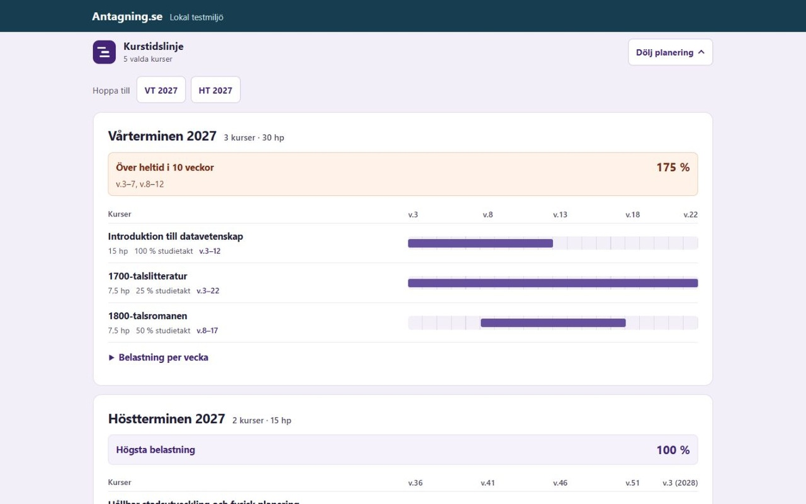

# Antagning.se Course Timeline

An unofficial Chrome and Edge extension for planning courses selected on Antagning.se. The Swedish-language planner shows course weeks, overlapping study periods and estimated weekly workload directly on the site. It is independent of Antagning.se and the Swedish Council for Higher Education (UHR).



## Install or reload locally

1. Download or clone this repository.
2. Open `chrome://extensions` in Chrome or `edge://extensions` in Edge.
3. Turn on **Developer mode**, choose **Load unpacked**, and select the folder containing `manifest.json`. If that folder is already installed, use **Reload** on the extension card.
4. Refresh Antagning.se and click **Visa planering** below the site header.

## Plan your courses

- Use **Lägg till** on Antagning.se to add a course to your plan. Selections follow you between search results, **Mina val**, and other pages. Courses saved only as favourites stay out of the planner.
- Each term starts with its peak workload and the weeks it goes above full-time study. Open **Belastning per vecka** for the full breakdown, including overlaps across terms.
- Course rows show the full week range, credits and study pace. **Uppskattat** marks estimated dates. Narrow screens show the same dates and pace in a list.
- Press **Escape** while focused inside the planner to close it. If its stored course list is stale, use **Läs in kurser på nytt** under **Om veckor och beräkningar**, then visit **Mina val** to refresh the full list.

Workload is an estimate. For courses worth higher education credits, the planner spreads the credits evenly across the course weeks and treats 1.5 hp per week as full-time study. For preparatory courses measured in fup, it uses the published study pace when available. Read the course information for specific teaching sessions and deadlines.

## Privacy

Course details and the panel preference are stored in the browser's local storage for the Antagning.se site. The extension uses no analytics and makes no network requests of its own. [Privacy policy](PRIVACY.md)

## Development

Use Node.js 18 or later.

```sh
npm ci
npm test
```

Open `test_comprehensive.html` to try the planner with sample data. **Töm exempelval** resets the demo to its empty state. The automated tests cover both current and legacy course cards, navigation, storage, and workload calculations.

## Publish to the Chrome Web Store

Create a ZIP with `manifest.json` at its root. Include `timeline.js`, `timeline.css` and `icons/`. In PowerShell, run this from the repository folder.

```powershell
Compress-Archive -Path manifest.json,timeline.js,timeline.css,icons -DestinationPath antagning-course-timeline-1.2.0.zip
```

Upload the ZIP as a new item in the [Chrome Web Store Developer Dashboard](https://chrome.google.com/webstore/devconsole/). For an existing listing, upload it as a new package and use a version number higher than every version previously uploaded for that item.

Use the screenshot above for the store listing. The package supplies the 128 × 128 icon. In **Privacy practices**, explain that the extension reads selected course information from Antagning.se pages to display the planner, stores it locally, and runs only the code bundled with the extension. Use the public URL for this repository's [privacy policy](PRIVACY.md). Under **Distribution**, choose visibility and countries, then submit the item for review. [Google's publishing instructions](https://developer.chrome.com/docs/webstore/publish)
